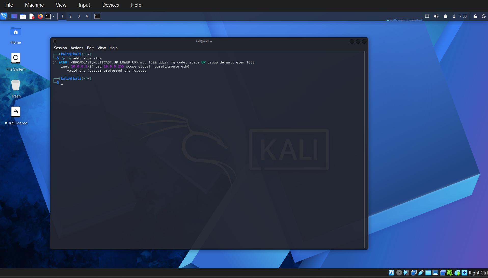
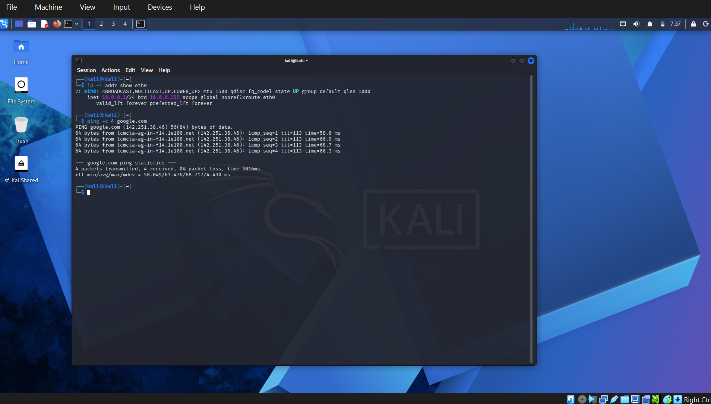
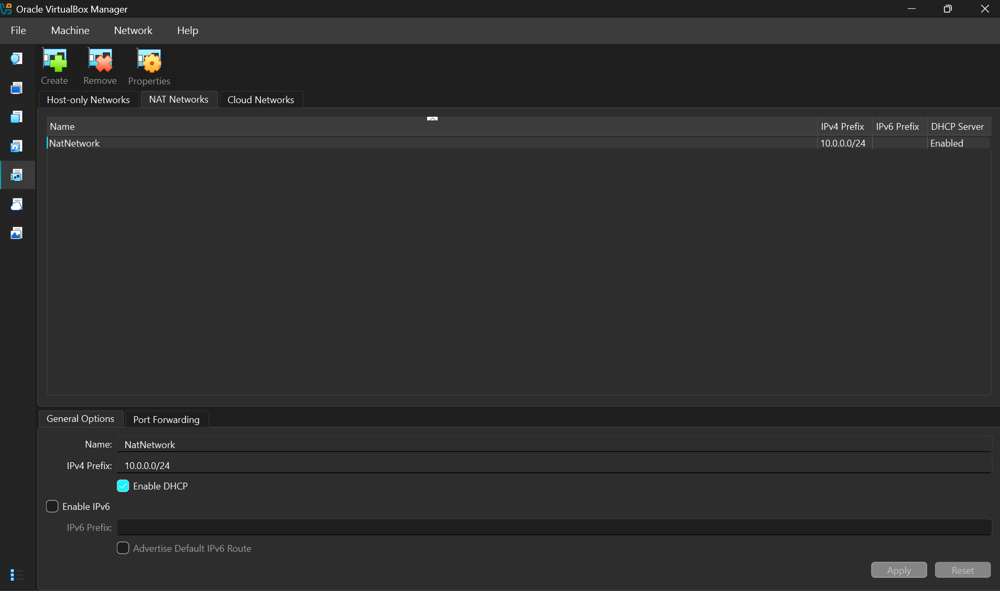
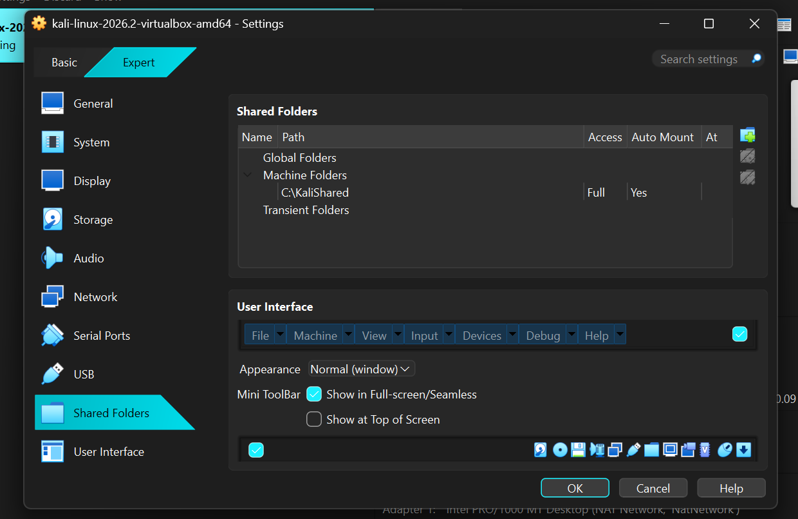
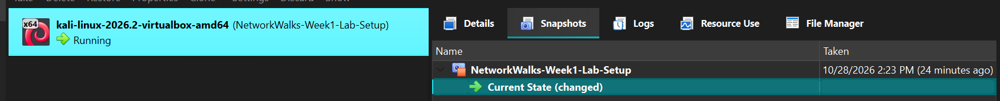

# Cybersecurity Lab Setup — Week 1

NetworkWalks Cybersecurity Internship | Project Module 1

## Overview

For my first week at the NetworkWalks Cybersecurity Internship, I worked on setting up a virtual cybersecurity lab using Kali Linux and Oracle VirtualBox.
The goal was to create a working environment where I could practice networking, Linux commands, and cybersecurity concepts without affecting my main operating system.
This project also gave me some hands-on experience with virtual networking, IP configuration, and troubleshooting.

## Tools Used

- **Oracle VirtualBox 7.2.22** — Virtualization platform
- **Kali Linux 2026.2** — Guest operating system
- **Windows 11** — Host operating system
- **7-Zip** — Extracting the Kali Linux VM files
- **GitHub** — Project documentation

## Lab Configuration

Virtual Machine - Kali Linux 2026.2 (64-bit) 
Network Adapter - NAT Network 
Network Name - NatNetwork 
Network Subnet - 10.0.0.0/24 
Kali Linux IP - 10.0.0.2/24 (Static) 
Default Gateway - 10.0.0.1 
DNS - 8.8.8.8, 1.1.1.1 
Shared Folder - C:\KaliShared 
Shared Clipboard - Bidirectional 
Drag and Drop - Bidirectional 

## What I Did

I started by installing Oracle VirtualBox and downloading the Kali Linux virtual machine image.
After extracting the files with 7-Zip, I added Kali Linux to VirtualBox and made sure the operating system was running properly.
Next, I created a NAT Network using the `10.0.0.0/24` subnet and connected Kali Linux to it.
Then I configured Kali Linux to use the required static IP address, `10.0.0.2/24`, and tested its internet connection.
I also enabled shared clipboard and drag-and-drop, configured a shared folder between Windows and Kali Linux and created a snapshot of the virtual machine.

## Screenshots

### 1. Kali Linux Static IP
Configured Kali Linux to use the required IP address, `10.0.0.2/24`.

### 2. Internet Connectivity
Tested internet access using the `ping` command. All four packets were received successfully, with 0% packet loss.

### 3. NAT Network Configuration
Created a custom NAT Network with the subnet `10.0.0.0/24`.

### 4. Shared Folder
Configured a shared folder between my Windows host and Kali Linux virtual machine.

### 5. Virtual Machine Snapshot
Created a snapshot after completing the initial lab setup so I could restore the virtual machine to this point if needed.

## Challenges I Faced

The setup wasn't completely straightforward, especially the networking part.
My first mistake was downloading the VMware version of Kali Linux instead of the VirtualBox version. I only realized this when I couldn't find the `.vbox` configuration file. After identifying the problem, I downloaded the correct image and imported it successfully.
Another challenge was configuring the required static IP address.
Initially, Kali Linux was using `10.0.2.15/24` because the network adapter was connected to VirtualBox's default NAT mode.
After changing the adapter to my custom NAT Network, Kali received `10.0.0.3/24` through DHCP instead of the required `10.0.0.2/24`.
I spent some time troubleshooting the network settings and checking the gateway, IP addresses, and connection configuration.
Eventually, I used the `nmcli` command to configure the static IP address manually.
After applying the changes, I verified that Kali Linux was using `10.0.0.2/24` and confirmed that internet connectivity was working.
This was probably the most challenging part of the project, but it also helped me understand the difference between NAT and NAT Network, DHCP and static IP addressing, and how network settings work inside a virtual machine.

## What I Learned

Through this project I gained practical experience with:
- Installing and configuring virtual machines
- Understanding NAT and NAT Network
- Configuring static IP addresses in Linux
- Using basic Linux networking commands such as `ip`, `ping`, and `nmcli`
- Troubleshooting virtual network connections
- Sharing files between host and guest operating systems
- Creating VM snapshots for recovery

## Final Result

By the end of Week 1, I had a working Kali Linux virtual machine with the required static IP configuration, internet connectivity, shared folder settings, and a snapshot.
The lab is now ready for future cybersecurity exercises and practical learning.
This project reminded me that setting up a lab isn't always just about following instructions. Sometimes things don't work as expected, and figuring out why is part of the learning process.

---

**Program:** NetworkWalks Cybersecurity Internship  
**Module:** Week 1 — Cybersecurity Lab Setup  
**Environment:** Windows 11 + Oracle VirtualBox + Kali Linux

*All lab activities are intended for learning and authorized cybersecurity practice.*
